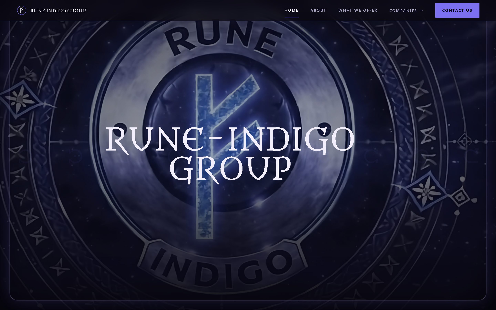
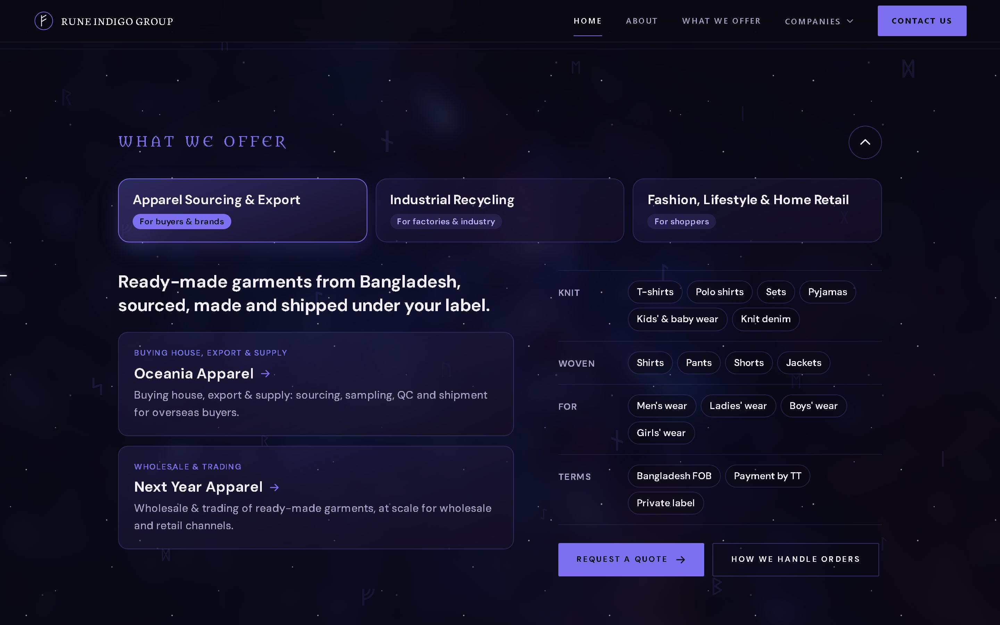
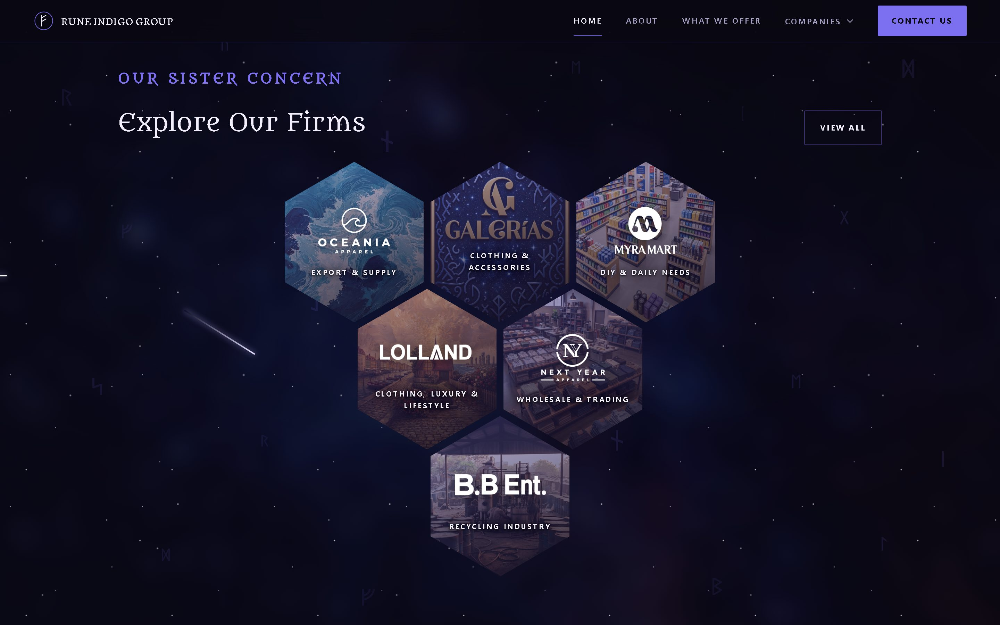
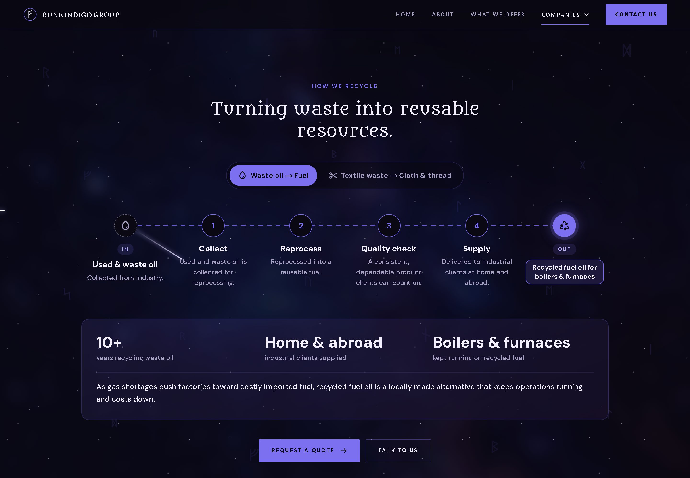
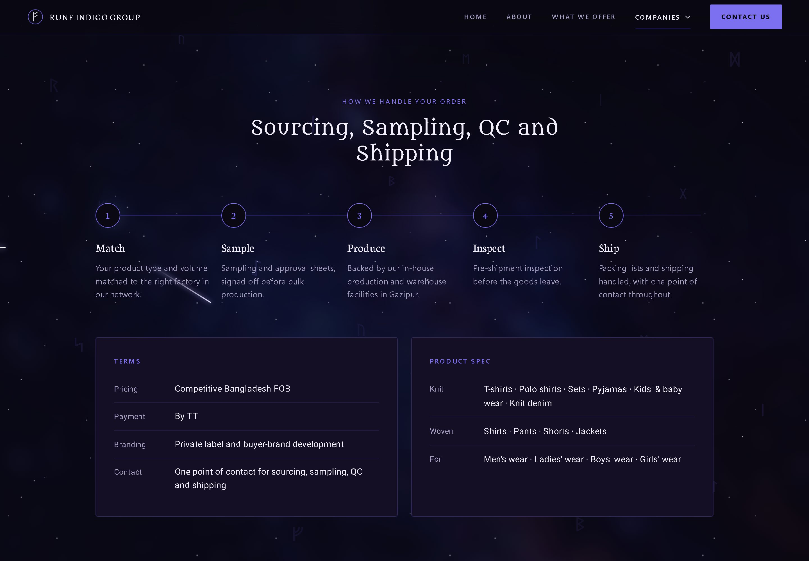
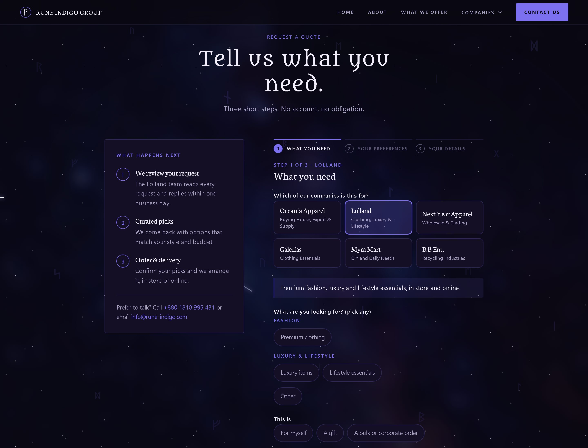
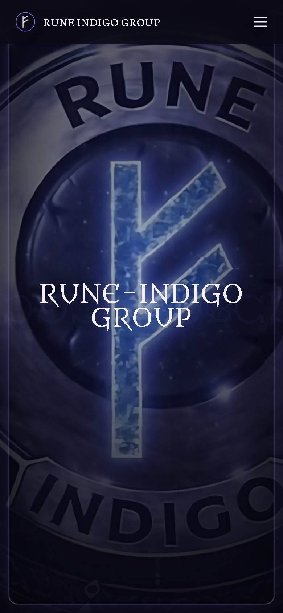
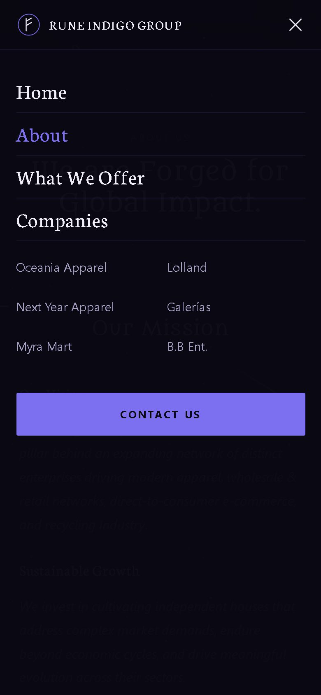
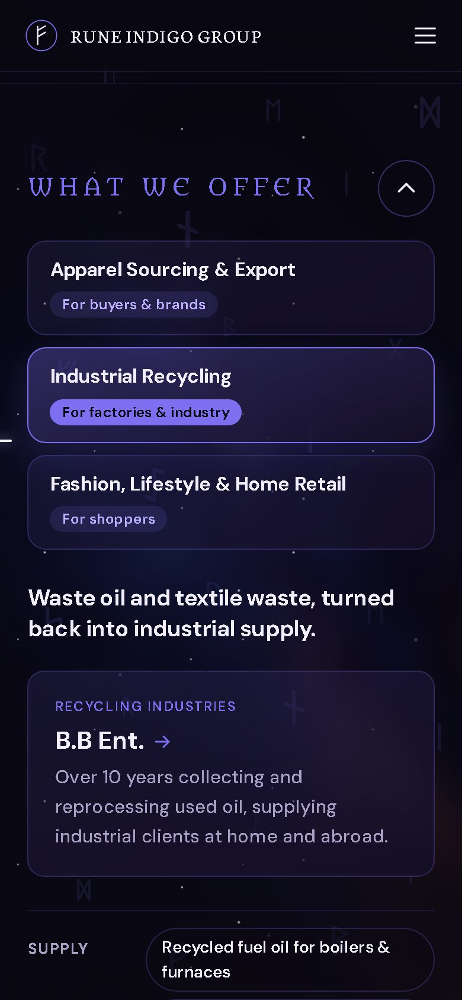
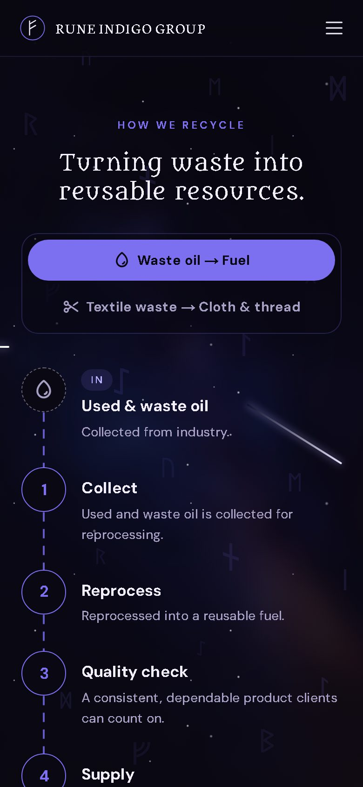

# Rune Indigo Group

**The website of a Bangladesh-based holding group of six firms — apparel sourcing & export, wholesale, retail, e-commerce and industrial recycling.**

[**→ Visit rune-indigo.com**](https://rune-indigo.com)

---

## About the project

Rune Indigo Group needed one site that speaks to three very different visitors: **overseas garment buyers**, **factories looking for recycled fuel and textiles**, and **everyday shoppers**. The site presents all six firms under one dark, rune-inspired identity, and turns visitors into enquiries with a quote form tailored to each firm.

## Highlights

- **Scroll-driven hero** — a full-bleed video that fades and zooms as you scroll, over a hand-built starfield with drifting runes and shooting stars.
- **"What We Offer" by niche** — three tabs (Apparel Sourcing & Export · Industrial Recycling · Fashion, Lifestyle & Home Retail), each written for the visitor it serves.
- **Honeycomb of firms** — a sticky hexagon cluster that reveals each company in sequence.
- **A different story on every company page** — an order timeline with terms for the buying house, and an interactive *waste in → resources out* flow for the recycling firm (oil and textile streams).
- **Six tailored quote forms** — pick a firm and the form rebuilds itself: its own products, questions, units and "what happens next" steps. Every request arrives labelled with the firm it is for.
- **Built for every device** — sticky navigation with a companies menu, a full-screen phone menu, 44px+ tap targets and safe-area support for notched phones.
- **Accessible by default** — keyboard navigation throughout, screen-reader labels, `prefers-reduced-motion` support, and content that still shows with JavaScript turned off.

## Screenshots

### Desktop

| | |
|:---:|:---:|
|  |  |
| **What We Offer** — one tab per niche | **Explore Our Firms** — the honeycomb |
|  |  |
| **How We Recycle** — waste in, resources out | **How We Handle Your Order** — timeline & terms |

<b>Request a Quote</b> — each firm gets its own form and next steps

### Phone

  
  
  
  

## Built with

| | |
|---|---|
| **Framework** | Next.js 16 (App Router, static export) · React 19 · TypeScript |
| **Styling** | CSS Modules with design tokens — no UI framework |
| **Type** | Metamorphous, Neuton, DM Sans, Roboto, Playfair Display |
| **Icons** | Phosphor Icons |
| **Hosting** | Cloudflare Workers with static assets |
| **Forms** | Serverless API on the same Worker, transactional email, Cloudflare Turnstile spam protection |

---

**[rune-indigo.com](https://rune-indigo.com)**

Designed & built by [@GitTheKakarot](https://github.com/GitTheKakarot) · The source code is private; this repository is a showcase.

© 2026 Rune Indigo Group. Logos, brand artwork and screenshots are not licensed for reuse.

